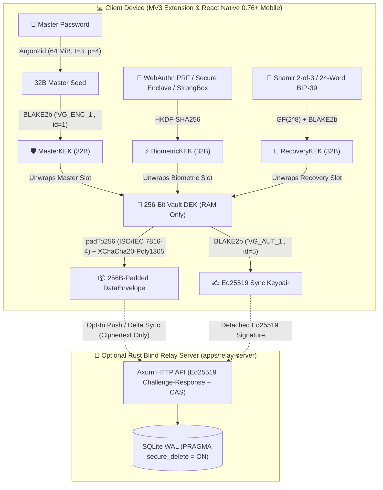

<p align="center">
  
</p>

# 🛡️ VaultGuard (Arca by Pixra)

**A 100% Offline, Zero-Knowledge Password Manager & 2FA Authenticator.**


## ✨ Key Features

* 🚫 **No Google Login & Zero Cloud Dependency:** No accounts, no email signups, no telemetry, and no third-party favicon tracking. Your vault initializes locally on your device in seconds.
* 🔒 **Local-First 2-Tier Envelope Encryption:** Powered by `libsodium` (`Argon2id` `64 MiB`, `t=3`, `p=4` + `BLAKE2b` subkey isolation + `XChaCha20-Poly1305-IETF` with 192-bit random nonces). Every item is padded to `256-byte` blocks (`ISO/IEC 7816-4`) prior to encryption so ciphertext sizes leak zero metadata.
* 🦀 **Optional Blind Sync (Rust Relay + HLC CRDT):** Synchronize across desktop and mobile without ever trusting the server. The self-hostable Rust Blind Relay (`apps/relay-server`) authenticates via `Ed25519` challenge-response signatures and merges encrypted blobs via Hybrid Logical Clock (`HLC`) LWW-Element-Set CRDTs (`PRAGMA secure_delete = ON`).
* 🔑 **Built-in TOTP (2FA) Authenticator & Offline QR Scanner:** Generate RFC 6238 6-digit and 8-digit 2FA codes with a live 30-second countdown ring (`Amber-500` transitioning to `Rose-500` under 5 seconds) and scan QR codes offline directly from your active browser tab.
* 🛡️ **5-Point Anti-Clickjacking Autofill Guard:** Injects zero DOM nodes into host webpages. Enforces `exact_origin` and `frameId === 0` in the MV3 background service worker via `chrome.tabs.query`, and walks all ancestor nodes for `opacity < 1`, `filter`, `clip-path`, and `visibility: hidden` before filling.
* 🔗 **Bot-Crawler-Safe One-Time Ephemeral Sharing:** Share credentials via `https://share.vaultguard.dev/#<shareId>:<shareKeyBase64>`. The 256-bit `shareKey` never leaves the URL `#` fragment, survives WhatsApp/Telegram link-preview bots, and burns via a keyed `BLAKE2b-256` `burnToken` upon human reveal.

## 🏗️ Architecture Diagram



## 🚀 Quick Start Guide: Install the Browser Extension Locally

### Option A: Load the Pre-Compiled Extension (`arca-extension-ready.zip`)
1. Unzip the ready-to-load extension package into your `Downloads` folder:
   ```bash
   unzip -o arca-extension-ready.zip -d ~/Downloads/arca-extension-ready
   ```
2. Open Chrome, Brave, or Edge and navigate to `chrome://extensions`.
3. Enable **Developer mode** using the toggle in the top-right corner.
4. Click **Load unpacked** and select `/home/radhe/Downloads/arca-extension-ready`.

### Option B: Build the Extension from Source
```bash
# 1. Install workspace dependencies
pnpm install

# 2. Compile TypeScript/TSX modules, run Acorn + ESLint checks, and build dist/
pnpm run build:extension
```

## 📱 How to Build for Android (React Native 0.76+)

The mobile app (`apps/mobile`) is built with **React Native 0.76+ (New Architecture & Hermes Engine)**, sharing `@pixra/arca-crypto` and `@pixra/arca-shared` directly with native C++ JSI Libsodium (`react-native-sodium-jsi`), `@op-engineering/op-sqlite` (`PRAGMA secure_delete = ON`), `react-native-keychain` (StrongBox / Keystore), and a native Kotlin `AutofillService` (`VaultGuardAutofillService.kt`).

### Prerequisites
* **Node.js `20+`** and **`pnpm 9+`**
* **JDK 17** (`JAVA_HOME` configured)
* **Android Studio / Android SDK** (API Level 34, Android NDK for JSI C++ compilation)

### Build & Run Commands
```bash
# 1. Install monorepo dependencies from the repository root
pnpm install

# 2. Bundle the production Hermes JS bundle for Android
cd apps/mobile
pnpm run bundle:android

# 3. Run on a connected Android device or emulator (Debug)
pnpm run android

# 4. Build a signed Release APK or Play Store Android App Bundle (.aab)
cd android
./gradlew assembleRelease   # Outputs APK in app/build/outputs/apk/release/
./gradlew bundleRelease     # Outputs Play Store .aab in app/build/outputs/bundle/release/
```

## 📚 Documentation Index

* `ARCHITECTURE.md` — Deep-dive Mermaid diagrams for 2-Tier Envelope Encryption, HLC CRDT Sync, and the 5-Point Anti-Clickjacking Guard.
* `SECURITY.md` — Zero-knowledge threat model and coordinated vulnerability disclosure policy.
* `CONTRIBUTING.md` — Developer environment setup, security invariants, and PR workflow.
* `docs/DEPLOYMENT.md` — Step-by-step production deployment guide for Render.com (Docker), Chrome Web Store, and Google Play Store (`.aab`).
* `apps/landing/index.html` — Standalone marketing landing page.

## 📄 License

Licensed under the **GNU Affero General Public License v3.0 (`AGPL-3.0`)**. See `LICENSE` for the full text.
